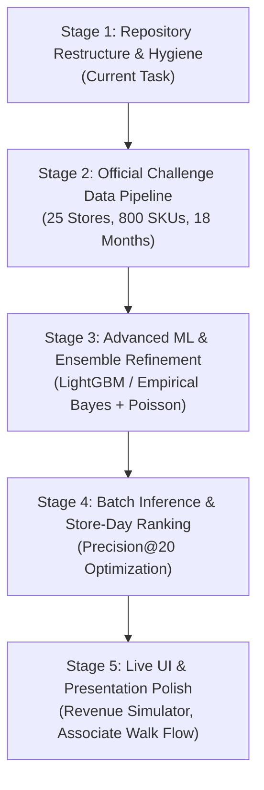

# Remaining Work & Implementation Plan: StockSentinel AI

**Event**: Talentap Mega Hackathon — Problem R1: *The Phantom Stock-Out Detector*  
**Date**: October 30, 2026  
**Status**: ACTIVE ROADMAP  

---

## 1. Roadmap Overview

This plan defines the structured phases to transition StockSentinel AI from repository restructuring to complete hackathon submission readiness.

---

## 2. Detailed Implementation Stages

### Stage 1: Repository Restructuring & Modularization (Current Task)
- [x] Complete project audit and baseline performance checks.
- [x] Create repository restructure plan (`docs/architecture/REPOSITORY_RESTRUCTURE_PLAN.md`).
- [x] Establish target folder structure:
  - `apps/api/`: FastAPI Microservice.
  - `ml/src/`: Modular Python ML package (demand, detection, ranking, explanations, evaluation).
  - `data/`: Standardized tiers (`raw/`, `interim/`, `processed/`, `sample/`).
  - `database/`: Canonical migrations, base schema, and SQL tests.
  - `scripts/`: CLI tools (`validate_data.py`, `run_detection.py`, `run_evaluation.py`).
  - `deployment/`: Dockerfiles and `docker-compose.yml`.
  - `docs/`: Complete architectural and technical documentation.
- [x] Update imports, test paths, package scripts, and `.gitignore`.
- [x] Verify zero regression across linting, type-checking, builds, and test suites.

---

### Stage 2: Official Dataset Ingestion & Preprocessing
**Target**: Handle ~25 stores $\times$ ~800 SKUs $\times$ 18 months (~10.9 million store-SKU-days).

1. **Schema Mapping**:
   - Map official hackathon CSV columns (Store ID, SKU, Date, Units Sold, On-Hand Inventory, Promo Flag, Retail Price).
2. **Data Ingestion Script (`scripts/validate_data.py`)**:
   - Check date format (`YYYY-MM-DD`).
   - Detect negative inventory or sales values.
   - Detect missing foreign key relationships between sales/inventory and store/product masters.
3. **Chunked Preprocessing**:
   - Create chunked parquet/duckdb or CSV preprocessors to handle large-scale time series without running out of RAM.

---

### Stage 3: ML Model Refinement & Ensemble Tuning
**Target**: Maximize Precision@20 while maintaining high Recall.

1. **Empirical Bayes Demand Prior**:
   - For low-volume SKUs, smooth baseline demand using category-level priors.
2. **Enhanced Feature Engineering**:
   - Cumulative zero days ($k$).
   - Ratio of consecutive zeros to mean inter-sale interval.
   - Recent pre-streak sales momentum (3-day sales before zero streak).
   - Inventory discrepancy ratio ($S / \lambda$).
   - Category shrinkage vulnerability index.
3. **Dual Ensemble Strategy**:
   - Combines explainable Poisson anomaly scoring with a gradient-boosted decision tree (LightGBM) trained on historical label verification data.

---

### Stage 4: Store-Day Top-20 Ranking & Submission Generation
**Target**: Generate daily investigation lists constrained to $\le 20$ items per store-day.

1. **Batch Ranking**:
   - Partition inference candidates by `(store_id, date)`.
   - Sort descending by calibrated anomaly risk score.
   - Enforce hard cutoff of exactly 20 candidates per store-day.
2. **Submission Formatter**:
   - Export official submission format required by the Talentap evaluator:
     `store_id, date, rank, sku, risk_score, estimated_lost_revenue`
3. **Automated Benchmark Runner**:
   - Evaluate against ground-truth test labels using `scripts/run_evaluation.py`.
   - Log Precision@10, Precision@20, Recall, and F1 across all evaluation stores.

---

### Stage 5: Executive Dashboard & Operational Walk Simulation
**Target**: Flawless live demonstration for competition judges.

1. **Store Switcher**:
   - Instant dropdown filtering between all 25 competition stores.
2. **Physical Shelf-Walk Simulation**:
   - Associate barcode scanner mock and touch-friendly mobile modal for logging physical shelf counts.
3. **ROI & Revenue Recovery Simulator**:
   - Real-time calculator projecting financial recovery:
     $$\text{Annual Recovered Revenue} = 25 \text{ stores} \times 20 \text{ walks/day} \times \$48.50 \times \text{Precision@20} \times 365$$
4. **Offline / Demo Resilience**:
   - Fully functional local demo mode requiring zero external internet or database access during judging.

