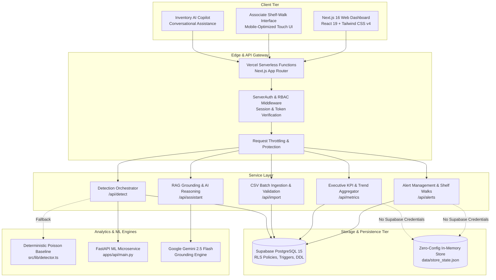

# System Architecture: StockSentinel AI

**Platform**: StockSentinel AI  
**Version**: 2.0.0 Architecture  
**Document**: Technical System Architecture  

---

## 1. High-Level Architectural Diagram

---

## 2. Multi-Tenant Role-Based Access Control (RBAC)

The system provides 5 discrete access states:
1. **`PLATFORM_ADMIN`**: Global governance across all companies and store chains.
2. **`COMPANY_MANAGER`**: Full authority across all stores within their corporate organization.
3. **`STORE_MANAGER`**: Locked to their single assigned store location; cannot view or modify data from other stores.
4. **`PENDING_ASSIGNMENT`**: New accounts awaiting corporate association.
5. **`SUSPENDED`**: Revoked access.

Access boundaries are enforced at three layers:
- **Client Route Guards** (`ProtectedRoute.tsx`)
- **Server-Side API Authorization** (`src/lib/auth/serverAuth.ts`)
- **Database Row-Level Security** (PostgreSQL RLS policies on tables)

---

## 3. Resilience and Failover Strategies

1. **Dual Detection Engine**: If the Python FastAPI microservice is offline or times out (>3.5s), Next.js immediately falls back to the built-in TypeScript Poisson baseline engine without user disruption.
2. **Dual Persistence Mode**: If Supabase PostgreSQL credentials are not set, the application operates in Demo Mode using an in-memory/JSON filesystem store pre-populated with realistic retail data.
3. **AI Provider Fallback**: If Google Gemini API is unavailable, the copilot can fall back to OpenAI GPT or report clear operational guidance grounded in local rules.

