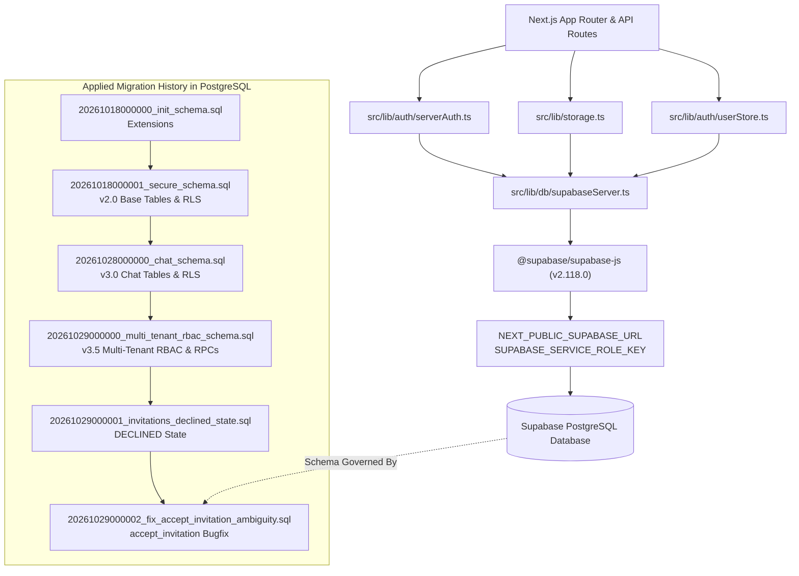

# Database Duplicate Audit & Architectural Analysis: StockSentinel AI

**Target Subsystem**: Database Schema, Migrations, Connection Clients, and Persistence Layer  
**Repository**: `StockSentinel-AI`  
**Date**: October 30, 2026  
**Auditor**: Senior Software Architect & Repository Migration Specialist  
**Status**: AUDIT COMPLETE — AWAITING USER APPROVAL PRIOR TO EXECUTION  

---

## 1. Executive Summary

This audit investigates potential duplicates, outdated implementations, conflicting configurations, and redundant files between `supabase/`, `database/`, the repository root (`schema.sql`), and application data access layers.

### Key Finding on the User's Initial Hypothesis
*User Hypothesis*: Suspected that `supabase/` contained an older implementation and `database/` contained a newer implementation.

*Audit Verdict*: **HYPOTHESIS DISPROVEN WITH CRYPTOGRAPHIC EVIDENCE.**
1. **Identical Bit-for-Bit Checksums**: Every SQL migration file in `database/migrations/` and `database/tests/` is an **exact 100% duplicate** of the corresponding file in `supabase/migrations/` and `supabase/tests/` (verified via SHA-256 hashes). Neither directory contains newer migrations than the other.
2. **The Real Outdated Implementation**: The genuinely outdated files are **`schema.sql`** (repository root) and **`database/schema/init_schema.sql`**. Both files represent an old **v2.0.0** base schema from October 18, 2026. They are missing:
   - Migration 3 (`20261028000000_chat_schema.sql`): `chat_conversations`, `chat_messages`
   - Migration 4 (`20261029000000_multi_tenant_rbac_schema.sql`): `companies`, `platform_administrators`, `company_memberships`, `store_assignments`, `invitations`, `company_id` columns, RBAC stored procedures, and store-isolated RLS policies.
   - Migration 5 (`20261029000001_invitations_declined_state.sql`): `DECLINED` invitation status check constraint.
   - Migration 6 (`20261029000002_fix_accept_invitation_ambiguity.sql`): Bugfix for `#variable_conflict use_column` in `accept_invitation()`.
3. **Application Coupling**: The application relies exclusively on `@supabase/supabase-js` targeting Supabase Auth and PostgreSQL via PostgREST. Standard Supabase CLI commands (`supabase db push`, `supabase migration up`) and test suites (`tests/migrationRbac.test.ts`) natively expect `supabase/`. Having `database/` duplicate all these files creates developer confusion and migration drift risk.

---

## 2. Complete File-by-File Duplicate Inventory

The following table catalogs every database-related file examined across `supabase/`, `database/`, root, and `src/`:

| File Path | Directory | Purpose | Content Relationship | Referenced By | Current Status | Recommended Action | Evidence |
| :--- | :--- | :--- | :--- | :--- | :--- | :--- | :--- |
| `supabase/migrations/20261018000000_init_schema.sql` | `supabase/` | Enables `uuid-ossp` and `pgcrypto` extensions | **Identical** to `database/migrations/20261018000000_init_schema.sql` | Supabase CLI, `tests/migrationRbac.test.ts` | Active | **Keep in `supabase/`** | SHA-256: `37DF94F5...` matches `database/` clone exactly. |
| `database/migrations/20261018000000_init_schema.sql` | `database/` | Enables `uuid-ossp` and `pgcrypto` extensions | **Identical** to `supabase/migrations/20261018000000_init_schema.sql` | `README.md` | Redundant Duplicate | **Remove after approval** | Duplicate copy created during structural reorganization. |
| `supabase/migrations/20261018000001_secure_schema.sql` | `supabase/` | Base v2.0.0 schema (stores, products, sales, inv, alerts, RLS) | **Identical** to `database/migrations/20261018000001_secure_schema.sql`; 99.9% identical to `schema.sql` | `src/app/settings/page.tsx`, `tests/migrationRbac.test.ts` | Active | **Keep in `supabase/`** | SHA-256: `4F2DED85...` matches `database/` clone exactly. |
| `database/migrations/20261018000001_secure_schema.sql` | `database/` | Base v2.0.0 schema | **Identical** to `supabase/migrations/20261018000001_secure_schema.sql` | `README.md` | Redundant Duplicate | **Remove after approval** | Duplicate copy created during structural reorganization. |
| `supabase/migrations/20261028000000_chat_schema.sql` | `supabase/` | AI Assistant persistence (`chat_conversations`, `chat_messages`, RLS) | **Identical** to `database/migrations/20261028000000_chat_schema.sql` | Supabase CLI, `tests/migrationRbac.test.ts` | Active | **Keep in `supabase/`** | SHA-256: `AEC03548...` matches `database/` clone exactly. |
| `database/migrations/20261028000000_chat_schema.sql` | `database/` | AI Assistant persistence | **Identical** to `supabase/migrations/20261028000000_chat_schema.sql` | `README.md` | Redundant Duplicate | **Remove after approval** | Duplicate copy created during structural reorganization. |
| `supabase/migrations/20261029000000_multi_tenant_rbac_rollback.sql` | `supabase/` | Rollback script reversing multi-tenant additions | **Identical** to `database/migrations/20261029000000_multi_tenant_rbac_rollback.sql` | `tests/migrationRbac.test.ts` (line 8) | Active Utility | **Move to `supabase/rollbacks/`** | SHA-256: `0F639165...` matches `database/` clone exactly. |
| `database/migrations/20261029000000_multi_tenant_rbac_rollback.sql` | `database/` | Rollback script | **Identical** to `supabase/migrations/20261029000000_multi_tenant_rbac_rollback.sql` | None directly | Redundant Duplicate | **Remove after approval** | Duplicate copy created during structural reorganization. |
| `supabase/migrations/20261029000000_multi_tenant_rbac_schema.sql` | `supabase/` | Multi-tenant RBAC DDL (companies, memberships, store assignments, RLS) | **Identical** to `database/migrations/20261029000000_multi_tenant_rbac_schema.sql` | `tests/migrationRbac.test.ts` (line 7) | Active | **Keep in `supabase/`** | SHA-256: `BBC66946...` matches `database/` clone exactly. |
| `database/migrations/20261029000000_multi_tenant_rbac_schema.sql` | `database/` | Multi-tenant RBAC DDL | **Identical** to `supabase/migrations/20261029000000_multi_tenant_rbac_schema.sql` | `tests/migrationRbac.test.ts` (fallback) | Redundant Duplicate | **Remove after approval** | Duplicate copy created during structural reorganization. |
| `supabase/migrations/20261029000001_invitations_declined_state.sql` | `supabase/` | Extends invitation CHECK constraint with 'DECLINED' | **Identical** to `database/migrations/20261029000001_invitations_declined_state.sql` | Supabase CLI, `tests/registrationAndInvitations.test.ts` | Active | **Keep in `supabase/`** | SHA-256: `B4319279...` matches `database/` clone exactly. |
| `database/migrations/20261029000001_invitations_declined_state.sql` | `database/` | Extends invitation CHECK constraint | **Identical** to `supabase/migrations/20261029000001_invitations_declined_state.sql` | None directly | Redundant Duplicate | **Remove after approval** | Duplicate copy created during structural reorganization. |
| `supabase/migrations/20261029000002_fix_accept_invitation_ambiguity.sql` | `supabase/` | Resolves column ambiguity in stored procedure `accept_invitation` | **Identical** to `database/migrations/20261029000002_fix_accept_invitation_ambiguity.sql` | `tests/migrationRbac.test.ts` (line 435) | Active | **Keep in `supabase/`** | SHA-256: `29C0E5FA...` matches `database/` clone exactly. |
| `database/migrations/20261029000002_fix_accept_invitation_ambiguity.sql` | `database/` | Resolves column ambiguity in stored procedure | **Identical** to `supabase/migrations/20261029000002_fix_accept_invitation_ambiguity.sql` | None directly | Redundant Duplicate | **Remove after approval** | Duplicate copy created during structural reorganization. |
| `supabase/tests/20261029000000_test_rbac_isolation.sql` | `supabase/` | SQL transaction-level test harness (10 test cases) | **Identical** to `database/tests/20261029000000_test_rbac_isolation.sql` | `tests/migrationRbac.test.ts` (line 9) | Active | **Keep in `supabase/tests/`** | SHA-256: `B2D474F0...` matches `database/` clone exactly. |
| `database/tests/20261029000000_test_rbac_isolation.sql` | `database/` | SQL transaction-level test harness | **Identical** to `supabase/tests/20261029000000_test_rbac_isolation.sql` | None directly | Redundant Duplicate | **Remove after approval** | Duplicate copy created during structural reorganization. |
| `schema.sql` | Root | Monolithic v2.0.0 schema script | **Identical** to `database/schema/init_schema.sql`; 99.9% duplicate of Migration 2 | `src/app/settings/page.tsx`, `README.md` | **Outdated / Obsolete** | **Consolidate to v3.5.0 or remove** | Lacks `companies`, `memberships`, `assignments`, `invitations`, and `chat_conversations`. |
| `database/schema/init_schema.sql` | `database/` | Copy of root `schema.sql` | **Identical** to root `schema.sql` | `docs/architecture/REPOSITORY_RESTRUCTURE_PLAN.md` | **Outdated / Obsolete** | **Replace with consolidated v3.5.0 schema** | SHA-256: `F2EAE97C...` matches root `schema.sql` exactly. Missing all v3.x tables. |
| `database/README.md` | `database/` | Documents migration order and RLS policies | Unique | Documentation index | Active Reference | **Move into `supabase/README.md`** | High-value documentation that belongs alongside the authoritative migrations. |
| `src/lib/db/supabaseClient.ts` | `src/lib/db/` | Browser Supabase client instance with auto-refresh | Unique | `AuthContext.tsx`, `assistant/page.tsx`, `auth/callback/page.tsx` | Active | **Preserve (Never delete)** | Core application database connection. |
| `src/lib/db/supabaseServer.ts` | `src/lib/db/` | Serverless Supabase client with Service Role or User Token | Unique | `storage.ts`, `userStore.ts`, API routes | Active | **Preserve (Never delete)** | Core server-side database connection. |
| `src/lib/db/seedDemoData.ts` | `src/lib/db/` | Seeds Supabase tables with demo products, stores, alerts | Unique | Settings / demo reset utilities | Active | **Preserve (Never delete)** | Production demo seeder. |
| `src/lib/storage.ts` | `src/lib/` | Data access abstraction (Supabase vs local memory) | Unique | All operational API routes | Active | **Preserve (Never delete)** | Core query layer. |
| `src/lib/auth/userStore.ts` | `src/lib/auth/` | Queries `profiles`, `companies`, `memberships`, `invitations` | Unique | `serverAuth.ts`, auth routes | Active | **Preserve (Never delete)** | Core RBAC query layer. |

---

## 3. Conflicting Schemas and Migration Version Gaps

### Conflict 1: The Monolithic Schema Trap (`schema.sql` vs. Full Migration Sequence)
- **The Problem**: `schema.sql` (and `database/schema/init_schema.sql`) declares itself as:
  `StockSentinel AI — PostgreSQL / Supabase Enterprise Schema Version: 2.0.0`
- **What is Missing**:
  1. `chat_conversations` and `chat_messages` tables (added in Migration 3).
  2. `companies`, `platform_administrators`, `company_memberships`, `store_assignments`, `invitations` tables (added in Migration 4).
  3. `company_id` foreign key columns on `stores`, `products`, `daily_sales`, `inventory_snapshots`, `promotions`, `alerts`, `detection_runs`, `verification_audit_log`, `import_jobs`, `chat_conversations`.
  4. Stored procedures: `accept_invitation()`, `onboard_company_transaction()`.
  5. Security functions: `can_access_store()`, `can_access_company()`, `is_platform_admin()`, `get_user_company_role()`.
  6. Updated RLS policies enforcing multi-tenant isolation.
- **Consequence**: If a developer copies and runs `schema.sql` into a fresh Supabase database as instructed by `src/app/settings/page.tsx`, the application will immediately crash with errors:
  `relation "public.companies" does not exist` or `relation "public.company_memberships" does not exist`.

### Conflict 2: Dual-Directory Migration Divergence Risk
- **The Problem**: `database/migrations/` and `supabase/migrations/` both exist with 7 identical files.
- **The Risk**: If an engineer adds a new migration (e.g. `20261101000000_add_department_forecasting.sql`) into `database/migrations/`, Supabase CLI will ignore it because it scans `supabase/migrations/`. Conversely, adding it to `supabase/migrations/` leaves `database/migrations/` out of sync.

### Conflict 3: Misleading In-App Instructions
- In [`src/app/settings/page.tsx:168-169`](file:///d:/StockSentinel-AI-/src/app/settings/page.tsx#L168-L169):
  ```tsx
  <p className="text-emerald-800 font-semibold">supabase/migrations/20261018000001_secure_schema.sql</p>
  <p className="text-slate-500">Also available in root: schema.sql (Copy into Supabase SQL Editor)</p>
  ```
  This actively instructs operators to run an incomplete, outdated schema.

---

## 4. Unique Files That Must Be Preserved

These files are unique, active, and essential to the running system:
1. `src/lib/db/supabaseClient.ts`: Active browser Supabase client.
2. `src/lib/db/supabaseServer.ts`: Active serverless Supabase service-role client.
3. `src/lib/db/seedDemoData.ts`: Database demonstration data seeder.
4. `src/lib/storage.ts`: High-level data access layer abstracting Supabase PostgREST queries.
5. `src/lib/auth/userStore.ts`: Authentication and RBAC data access functions.
6. `src/types/index.ts`: TypeScript contracts for all database entities.
7. `database/README.md`: High-value architectural documentation (should be preserved and moved to `supabase/README.md`).
8. `supabase/migrations/20261029000000_multi_tenant_rbac_rollback.sql`: Essential disaster recovery rollback utility.
9. `supabase/tests/20261029000000_test_rbac_isolation.sql`: 10-suite SQL transaction-level RBAC test harness.

---

## 5. Genuinely Obsolete Files with Evidence

| File | Status | Technical Evidence Supporting Removal |
| :--- | :--- | :--- |
| `schema.sql` (root) | **Confirmed Obsolete** | It is an exact duplicate of `20261018000001_secure_schema.sql` (v2.0.0). It does not contain v3.0 or v3.5 tables. It does not reflect the current application state. |
| `database/schema/init_schema.sql` | **Confirmed Obsolete** | Exact SHA-256 duplicate (`F2EAE97C...`) of the root `schema.sql`. Contains the same outdated v2.0.0 schema. |
| Entire `database/migrations/` directory (7 files) | **Confirmed Obsolete** | Exact SHA-256 duplicates of all 7 files in `supabase/migrations/`. Created during folder reorganization; redundant. |
| `database/tests/20261029000000_test_rbac_isolation.sql` | **Confirmed Obsolete** | Exact SHA-256 duplicate (`B2D474F0...`) of `supabase/tests/20261029000000_test_rbac_isolation.sql`. |

---

## 6. Authoritative Database Implementation

### Dependency Chain: From Startup to Database Query



### Authoritative Implementation Conclusions:
1. **Target Database**: **Supabase PostgreSQL** via `@supabase/supabase-js` (PostgREST over HTTPS). There is zero direct `pg` or `Prisma` connection.
2. **Authoritative Migration History**: The 6 forward migrations in `supabase/migrations/` (ending in `20261029000002_fix_accept_invitation_ambiguity.sql`).
3. **Canonical Location**: **`supabase/`** is the standard, authoritative location. It is natively recognized by the Supabase CLI, standard Vercel integrations, and existing tests in `tests/migrationRbac.test.ts`.

---

## 7. Recommended Target Database Directory Structure

To eliminate duplicates while maintaining clean separation of concerns:

```text
supabase/
├── migrations/                                      # The ONLY authoritative migration directory
│   ├── 20261018000000_init_schema.sql              # Migration 1: Extensions
│   ├── 20261018000001_secure_schema.sql            # Migration 2: Base schema v2.0
│   ├── 20261028000000_chat_schema.sql              # Migration 3: Chat schema v3.0
│   ├── 20261029000000_multi_tenant_rbac_schema.sql # Migration 4: Multi-tenant RBAC v3.5
│   ├── 20261029000001_invitations_declined_state.sql # Migration 5: Declined state check
│   └── 20261029000002_fix_accept_invitation_ambiguity.sql # Migration 6: RPC parameter bugfix
├── rollbacks/                                       # Separated from forward migrations
│   └── 20261029000000_multi_tenant_rbac_rollback.sql
├── schema/                                          # Single consolidated DDL for new dev environments
│   └── complete_schema_v3.5.sql                    # Fully consolidated v3.5.0 DDL (all tables, functions, RLS)
├── tests/                                           # SQL-level isolation test harness
│   └── 20261029000000_test_rbac_isolation.sql
└── README.md                                        # Consolidated migration & RLS architecture guide
```

*Note on `database/`*: Once all migrations, tests, and documentation are unified under `supabase/`, the redundant `database/` directory can be removed entirely.

---

## 8. Application References That Would Break if Removed Incorrectly

The following application references must be updated as part of any approved consolidation:

1. **`tests/migrationRbac.test.ts`**:
   - Line 7: `MIGRATION_PATH` (currently checks `database/migrations/` then falls back to `supabase/migrations/`).
   - Line 8: `ROLLBACK_PATH` (hardcoded to `supabase/migrations/...`).
   - Line 9: `TEST_SQL_PATH` (hardcoded to `supabase/tests/...`).
   - Line 435: `mig6Path` (hardcoded to `supabase/migrations/...`).
2. **`src/app/settings/page.tsx`**:
   - Lines 168–169: References `supabase/migrations/20261018000001_secure_schema.sql` and `schema.sql`. Must be updated to guide users to the complete migration sequence or a consolidated v3.5 schema.
3. **`README.md`**:
   - Lines 25, 115, 128: References both `database/migrations/` and `schema.sql`. Must be updated to point to `supabase/migrations/`.
4. **`docs/`**:
   - References in `docs/setup/QUICKSTART.md`, `docs/architecture/REPOSITORY_RESTRUCTURE_PLAN.md`, and `docs/api/API_REFERENCE.md`.

---

## 9. Safe Migration & Cleanup Plan (For User Approval)

The following steps will be executed **only after user review and confirmation**:

### Step 1: Create Consolidated Complete Schema (`supabase/schema/complete_schema_v3.5.sql`)
Assemble all 6 migrations into a single, clean idempotent DDL script. This provides a one-click setup script for new Supabase instances without forcing developers to execute 6 separate files manually.

### Step 2: Relocate Rollback Script
Move `supabase/migrations/20261029000000_multi_tenant_rbac_rollback.sql` into `supabase/rollbacks/` so that automated Supabase CLI runs only execute forward migrations.

### Step 3: Relocate Database Documentation
Move `database/README.md` to `supabase/README.md` and enrich it with the complete v3.5 architecture reference.

### Step 4: Remove Redundant Duplicate Files
Remove:
- `database/migrations/` (all 7 duplicate files)
- `database/schema/init_schema.sql` (outdated duplicate)
- `database/tests/20261029000000_test_rbac_isolation.sql` (duplicate)
- `database/` (directory cleanup)
- Root `schema.sql` (outdated duplicate)

### Step 5: Update Application & Test References
- Update `tests/migrationRbac.test.ts` to reference `supabase/migrations/` and `supabase/rollbacks/`.
- Update `src/app/settings/page.tsx` to display the authoritative setup instructions.
- Update `README.md` and `docs/setup/QUICKSTART.md`.

### Step 6: Post-Cleanup Verification Run
Execute the full test and verification suite:
- `npm run lint`
- `npm run build`
- `npm test` (all 11 test suites)
- `python -m unittest discover -s ml/tests`
- `python scripts/run_evaluation.py`

